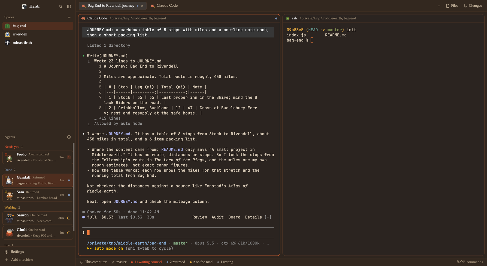

# Middle-earth for Herdr

A Lord of the Rings layout for the [Herdr](https://herdr.dev) desktop app. Your agents become the Fellowship and your spaces become the realms. Light mode is the Shire and dark mode is Mordor.




- **Agents:** Gandalf, Frodo, Sam, Legolas and Gimli, as animated pixel sprites. Sauron joins in dark mode.
  - **Idle:** they smoke a pipe.
  - **Working:** they fight.
  - **Blocked:** they raise a `!`.
  - **Done:** they bring back the Ring.
- **Spaces:** each space gets a realm emblem: Shire, Rivendell, Gondor, Rohan, Lórien, Moria or Mordor.
- **Notifications:** toasts and macOS banners in character, with the sprite ("Gandalf returned from the quest").
- **Status bar:** counts agents by state ("2 on the road · 1 awaiting counsel").
- **Also included:** a Claude Code icon holding the Ring, a hobbit-door shell icon, Palatino, and custom alert sounds.

## Install

```sh
git clone https://github.com/joaovitorwoliveira/herdr-middle-earth
cd herdr-middle-earth
./install.sh
```

The script copies the layout, themes and mods into `~/.config/herdr-app` (`HERDR_APP_HOME` picks another folder) and switches to the layout. It also merges the sounds into `settings.json` and the program icons into `programs.json`. Anything it replaces is kept as `*.bak-<time>`. `ctrl-shift-l` switches back to your layout.

Or ask your agent: *"Add the Herdr layout at github.com/joaovitorwoliveira/herdr-middle-earth"*. Herdr's `AGENTS.md` tells it how.

### macOS banners (optional)

```sh
brew install terminal-notifier
open "$(brew --prefix terminal-notifier)/terminal-notifier.app"   # allow notifications once
```

Without it, you still get the in-app toasts and sounds. A Focus mode hides banners unless `terminal-notifier` is allowed in it.

## Editing the art

The sprites are 16x16 grids in `tools/sprites.py`. To regenerate them, run:

```sh
python3 tools/sprites.py    # SVG sprites and realm emblems
python3 tools/banners.py    # PNG banners for notifications (needs Pillow)
```

`RECIPE.md` describes the whole build, for anyone (or any agent) rebuilding it from scratch.
