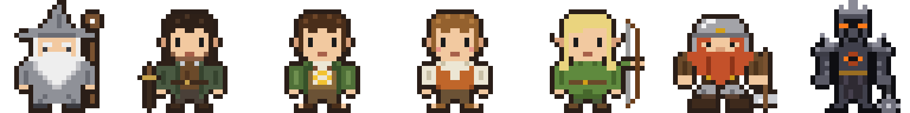
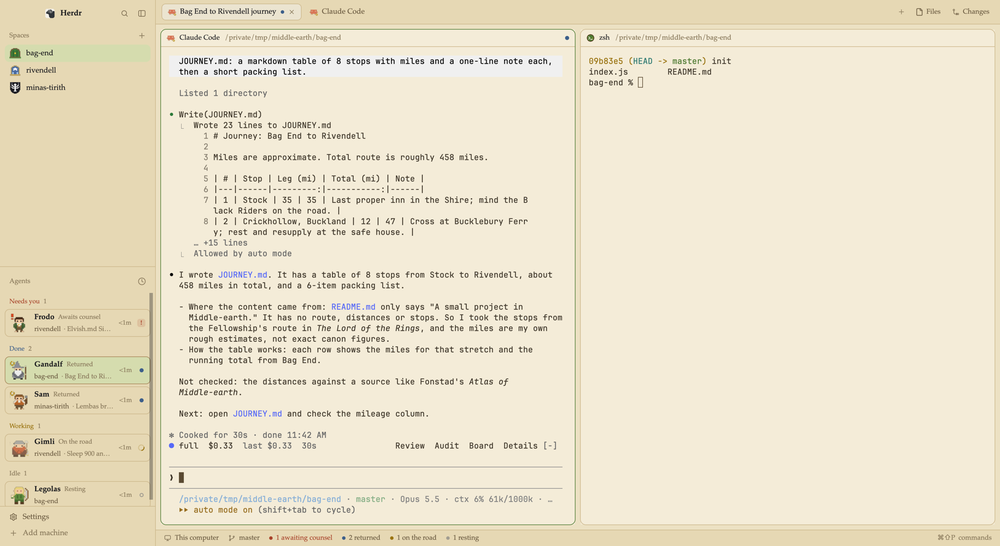

<p align="center">
  
</p>

<h1 align="center">Middle-earth for Herdr</h1>

<p align="center">
  <em>One layout to rule your agents.</em><br>
  A Lord of the Rings layout for the <a href="https://herdr.dev">Herdr</a> desktop app.
</p>

<p align="center">
  
  
  
</p>

Your agents become the Fellowship and your spaces become the realms. Light mode is the Shire and dark mode is Mordor.




- **Agents:** Gandalf, Frodo, Sam, Legolas and Gimli, as animated pixel sprites. Sauron joins in dark mode.
  - **Idle:** they smoke a pipe.
  - **Working:** they fight.
  - **Blocked:** they raise a `!`.
  - **Done:** they bring back the Ring.
- **Spaces:** each space gets a realm emblem: Shire, Rivendell, Gondor, Rohan, Lórien, Moria or Mordor.
- **Notifications:** toasts and macOS banners in character, with the sprite ("Gandalf returned from the quest").
- **Status bar:** counts agents by state ("2 on the road · 1 awaiting counsel").
- **Also included:** a Claude Code icon holding the Ring, a hobbit-door shell icon, the TeX Gyre Pagella font (a free Palatino clone, bundled), and custom alert sounds.

## Install

Made for Herdr 0.1.16. Tested on macOS. Linux and Windows should work but are untested.

### macOS and Linux

```sh
git clone https://github.com/joaovitorwoliveira/herdr-middle-earth
cd herdr-middle-earth
./install.sh
```

The script copies the layout, themes and mods into `~/.config/herdr-app` (`HERDR_APP_HOME` picks another folder) and switches to the layout. It also merges the sounds into `settings.json` and the program icons into `programs.json`. Anything it replaces is moved to `backups/middle-earth-<time>/`. `ctrl-shift-l` switches back to your layout. The script needs `bash` and `python3`.

### Windows, or with your agent

Ask your agent: *"Add the Herdr layout at github.com/joaovitorwoliveira/herdr-middle-earth"*. Herdr's `AGENTS.md` tells it how, and `RECIPE.md` lists the extra steps: the themes and the sounds and icons snippets.

### System banners (optional)

macOS:

```sh
brew install terminal-notifier
open "$(brew --prefix terminal-notifier)/terminal-notifier.app"   # allow notifications once
```

A Focus mode hides banners unless `terminal-notifier` is allowed in it.

Linux: needs `notify-send` (package `libnotify-bin` or `libnotify`). Windows: in-app toasts only.

Without these, you still get the in-app toasts and sounds.

## Editing the art

The sprites are 16x16 grids in `tools/sprites.py`. To regenerate them, run:

```sh
python3 tools/sprites.py    # SVG sprites and realm emblems
python3 tools/banners.py    # PNG banners for notifications (needs Pillow)
```

`RECIPE.md` describes the whole build, for anyone (or any agent) rebuilding it from scratch.

## Contributing

Issues and pull requests are welcome, and reports from Linux and Windows help the most. See [CONTRIBUTING.md](CONTRIBUTING.md) for how to test a change.

## License

MIT, except the TeX Gyre Pagella font in `mods/fellowship/fonts/`, which is under the GUST Font License included beside it.
