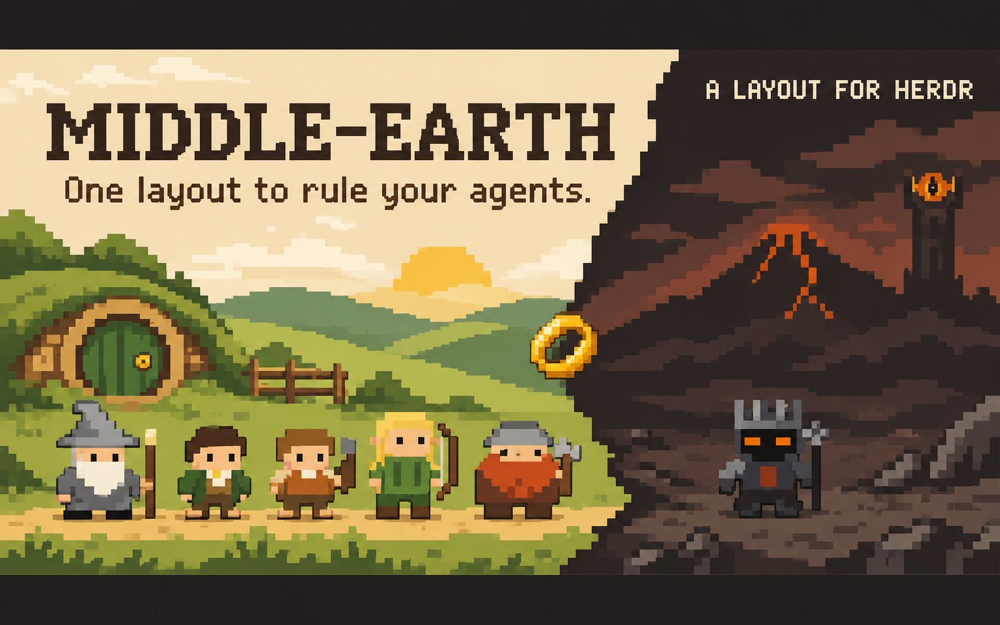
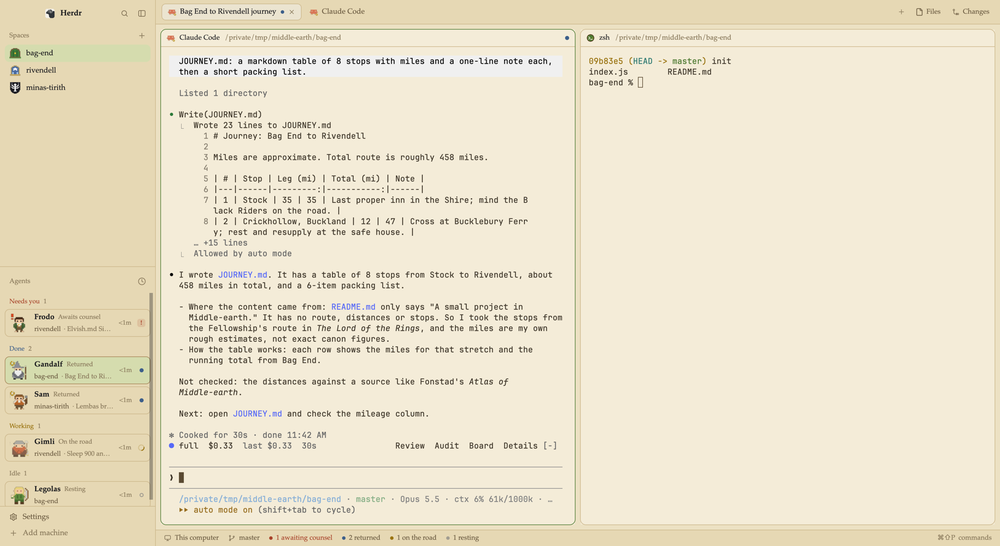

# Middle-earth

Your agents become the Fellowship: animated pixel sprites that smoke a pipe while idle, fight while they work and bring back the Ring when done. The Shire in light mode, Mordor in dark, where Sauron joins the cast.

## What you see

The window is a row with no system title bar (`"titlebar": "none"`). The macOS window buttons sit at `[12, 16]`. Ui font: TeX Gyre Pagella, a free Palatino clone that ships in `mods/fellowship/fonts/`, so it looks the same on every system. Terminal padding: `[14, 12]`. A 1px `border` divider runs between the columns.

- **Sidebar, left, 268px** (min 44, max 480, not resizable), on `chrome`:
  - **Brand**, 46px: the shipped `workspace-chrome`. It is a window drag area.
  - **Spaces** (`realms`), weight 1, min 90: each space shows a 20px pixel emblem instead of a colored letter tile. There are seven realms in order: Shire, Rivendell, Gondor, Rohan, Lórien, Moria and Mordor.
  - **Agents** (`fellowship`), weight 1, min 90: each agent row shows a 32px sprite, the character's name in semibold, and a status word in `muted` ("On the road", "Resting", "Awaits counsel", "Returned"). Below these sit the space and the tab title in 11.5px.
  - **Footer**, 69px: `workspace-chrome` with `{ "footer": true }` (Settings, Add machine).
- **Work column**, right:
  - **Tabs**, 42px: the shipped `tabs`. It is a window drag area.
  - **Body**: a row with padding 8 and gap 8. The active tab's panes are cards: radius 10, a 1px `border` that turns `accent` on focus, and a 30px `pane` header always shown. A Files/Changes stack (368px, min 280, max 900) starts hidden on the right.
  - **Status bar**, 28px (`fellowship-status`): the machine, the branch, then one colored dot and count per agent state that has agents: "N awaiting counsel" (blocked, in the `blocked` color), "N returned", "N on the road", "N resting". With no agents it says "The road is quiet". The palette hint sits on the far right.

Themes: `{ "light": "shire", "dark": "mordor" }` set on the layout.

- **Shire**: background `#f4ecd8`, text `#3a3226`. Colors: accent `#4e7a32`, chrome `#e6d8b4`, canvas `#ece1c3`, popover `#faf4e4`, border `#cdb88c`, input `#a8875a`, hover `#ddcda2`, selected `#d5dcae`, muted `#6a5a40`, dim `#8a7a5c`.
- **Mordor**: background `#2b2420`, text `#e4d6c2`. Colors: accent `#e0662e`, chrome `#33281f`, canvas `#2f251e`, popover `#3a2e26`, border `#563826`, input `#7a4a2e`, hover `#3f3027`, selected `#4f2e1f`, muted `#c9b8a0`, dim `#a08e76`.

Program icons: Claude Code keeps its orange creature, now holding a gold ring. The shell is a round green hobbit door with a cream `>_` and a gold knob, drawn as a picture (`tint: false`).

## How it behaves

- **Casting.** A new agent takes a random free member of Gandalf, Aragorn, Frodo, Sam, Legolas and Gimli. If the system is dark when the agent appears, Sauron is one more member of the draw. The choice is kept per terminal address in shared `fellowship.cast`, so the character survives restarts and later theme changes. When every member is taken, the cast starts over: the next agent gets a random pick among the least-used members.
- **Working:** the character fights. Two frames swap every 800ms:
  - Gandalf: sparks burst from his staff.
  - Aragorn: draws his sword from its scabbard and thrusts.
  - Frodo: Sting glows blue.
  - Sam: swings a frying pan.
  - Legolas: draws his bow and looses an arrow.
  - Gimli: brings his axe down.
  - Sauron: strikes with a burning mace while his eyes flare.
- **Idle:** eyes closed, two frames every 1800ms:
  - Gandalf, Aragorn, Frodo, Sam and Gimli: a pipe with a glowing ember and a smoke ring rising.
  - Legolas: takes a bite of lembas instead.
  - Sauron: his Eye smoulders.
- **Blocked:** a still sprite with a red `!` in the top-left corner.
- **Done:** a still sprite with a small gold Ring in the top-left corner.
- **Toasts** (`fellowship-toast`, set as the layout's `toast`):
  - "<program> finished" becomes "<Hero> returned from the quest".
  - "<program> needs you" becomes "<Hero> awaits your counsel".
  - The body reads "<program> · <body>" and the toast shows the matching 28px sprite.
  - Other toasts look like Herdr's own, with an 18px icon.
- **System banners:** when the Herdr window is not active, the same text goes to the system too, with the character's 128px PNG as the picture.
  - macOS: Notification Center through `terminal-notifier`. Clicking the banner brings Herdr forward.
  - Linux: `notify-send`.
  - Windows: no banner, only the in-app toast.
- **Sounds:** a custom done sound and a custom blocked sound.
- **Everything else** (clicks, keys, sorting, pinning, sub-agents) is the shipped `agents`, `spaces` and `toast` behavior.

## Built from

- **Layout:** a clone of `main` 0.1.16 (`layouts/middle-earth.json`). Root keys: `theme`, `ui_font`, `toast`, `titlebar`, `traffic_lights`, `preview` (`layouts/middle-earth.png`, which the settings screen shows).
- **Shipped mods used as they are:** `workspace-chrome`, `tabs`, `pane`, `files` and `changes`.
- **`fellowship`:** a clone of `agents`.
  - `castFor` assigns the characters, using `shared` / `setShared` and `settings().dark`.
  - `heroSprite` picks the pose. A two-frame swap is two stacked `image()`s whose `opacity` loops linearly from 7 to -6 and from -6 to 7. The over-range values clamp, so each frame stays fully on or fully off for half of the period: a crisp swap instead of a fade.
  - Sprites are in `sprites/<hero>[-work|-2|-idle|-idle-2|-blocked|-done].svg`: six heroes with seven files each.
  - The folder also holds `banners/<hero>-<blocked|done>.png`, `sounds/` and `program-icons/`.
- **`fellowship-status`:** a clone of `workspace-status`, with counts from `agents()` by status.
- **`fellowship-toast`:** a clone of `toast`.
  - `heroOf()` matches the title against `/^(.+) (finished|needs you)$/`. It reads the terminal from `action.args.terminal` when the action is `agent.focus`, then looks up `fellowship.cast`.
  - `init()` posts to the system by `window().platform`. On macOS it uses `exec("terminal-notifier", [...])` with `-activate dev.herdr.app -contentImage <appHome>/<png>`, falling back to `osascript` if that fails. On Linux it uses `exec("notify-send", ["-a", "Herdr", "-i", <png>, title, body])`. It skips this when `window().active` or during `checking()`.
- **`realms`:** a clone of `spaces`. It keeps each space's realm in shared `realms.emblems` and draws `emblems/<realm>.svg`.
- **Outside the layout:**
  - `programs.json` sets the `claude` and `shell` icons.
  - `settings.json` sets `sounds.done` and `sounds.blocked`, relative to the home.
  - `install.sh` merges both files.
- **Art:** `tools/sprites.py` writes every SVG from character grids (24x24 agents, 16x16 realm emblems), with `shape-rendering="crispEdges"`. `tools/banners.py` (Pillow) scales the blocked and done poses 8x with nearest-neighbor into PNGs.

## Watch out

- **Installing takes more than `layouts/` and `mods/`.** An agent adding this layout must also:
  1. Copy `themes/shire.json` and `themes/mordor.json` to the home's `themes/`. Without them the layout shows the person's own theme.
  2. Copy `layouts/middle-earth.png` beside the layout file. Settings shows it as the layout's picture.
  3. Merge `settings.snippet.json` into the home's `settings.json` (the `sounds` keys) and `programs.json` into the home's `programs.json` (the `claude` and `shell` entries), key by key, keeping everything else.

  On macOS and Linux, `./install.sh` does all of this and moves anything it replaces to `backups/middle-earth-<time>/`. On Windows, do it by hand.
- **Version:** built and tested on Herdr 0.1.16, macOS. Linux and Windows follow the code and Herdr's docs, but nobody has tested them.
- **Palette keys:** each grid character maps to a color per sprite. Overlays such as smoke, badges and weapons must use keys that the base palette does not use: smoke uses `1` to `6`. Otherwise they recolor a beard or a pack.
- **Badges** are drawn into the empty top-left 4x5 corner. The generator asserts that the corner is empty.
- **Program icons and sounds** belong to the person's own files, not to the layout. Herdr reads them from `programs.json` and `settings.json` for every layout.
- **Banners from inside Herdr:**
  - `osascript display notification` exits 0 but shows nothing, so `terminal-notifier` is needed.
  - `terminal-notifier` has to be allowed once: open its `.app`.
  - A Focus mode hides banners unless `terminal-notifier` is allowed in it.
- **Posting from `init()`:** the post happens in `init()`, not in `render()`. `render()` may never run while the window is on another macOS Space.
- **Pagella** loads from `mods/fellowship/fonts/` (Herdr loads a mod's `fonts/` at start and on the next look change). Its license, GUST, sits beside the files.
- **Image loading:** images load lazily, so the first frame after a switch can show empty sprite slots.

## Done when

- `herdr-app check mods/<name>` passes for `fellowship`, `fellowship-toast`, `fellowship-status` and `realms`.
- `layout.switch {"name":"middle-earth"}` shows the Shire in light mode and Mordor in dark mode, in TeX Gyre Pagella.
- Starting a Claude Code agent adds a random member (Sauron can be drawn when dark) with a working animation. When the agent waits, it switches to the idle pipe.
- A second agent gets the next free character, and the characters stay the same after a restart.
- A finished agent shows "<Hero> returned from the quest" with the Ring sprite and plays `done-alert.mp3`.
- With another app in front and `terminal-notifier` installed, the same message arrives as a macOS banner with the sprite.
- The status bar counts agents by state, or says "The road is quiet".
